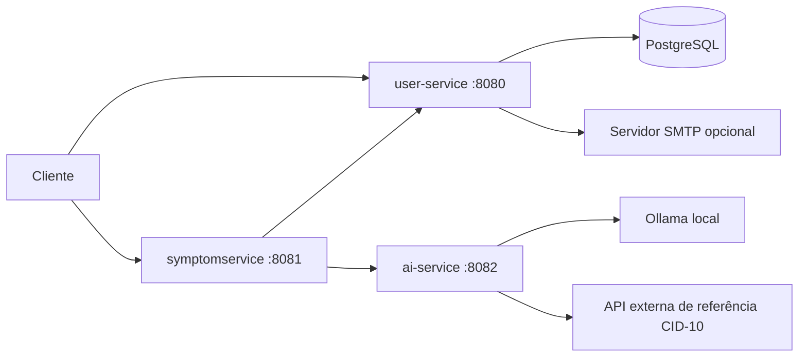

# Health Triage API

[](https://openjdk.org/projects/jdk/25/)
[](https://spring.io/projects/spring-boot)
[](https://www.postgresql.org/)
[](https://ollama.com/library/qwen3.5)
[](https://jwt.io/)
[](#testes)
[](#inicialização-rápida-no-windows)

Backend de triagem inicial de sintomas, desenvolvido em Java com Spring Boot e organizado em três microsserviços. Este repositório contém apenas APIs, sem interface web. A API recebe sintomas informados pelo usuário, encaminha a solicitação a um modelo local via Ollama e retorna uma orientação preliminar. Também oferece cadastro e autenticação de usuários, gerenciamento de conta, recuperação de senha por e-mail e consulta de códigos CID-10.

> **Aviso:** esta aplicação é um projeto de portfólio e fornece apenas conteúdo informativo. A resposta da IA não é diagnóstico médico, não substitui avaliação profissional e não deve ser usada para decisões clínicas ou emergências.

## Em 30 segundos

- Três APIs Spring Boot 4: usuários, sintomas e orientação preliminar.
- PostgreSQL 16 para contas; JWT para autenticação entre os serviços.
- Ollama local com `qwen3.5:4b` como modelo padrão do `ai-service`.
- Consulta CID-10 por uma API externa de referência.
- Inicialização local por PowerShell e Docker Desktop; 10 testes Maven e um teste de ponta a ponta.

## Links

- [Repositório no GitHub](https://github.com/jzmlucas/health-triage-api)
- [Inicialização local](#inicialização-rápida-no-windows)
- [Rotas principais](#rotas-principais)
- [Testes](#testes)

## Arquitetura



| Serviço | Responsabilidade | Porta padrão |
|---|---|---:|
| `user-service` | Cadastro, login, perfil, troca e recuperação de senha | `8080` |
| `symptomservice` | Recebe sintomas, valida o usuário e coordena o pedido de orientação | `8081` |
| `ai-service` | Gera resposta preliminar com Ollama e consulta códigos CID-10 | `8082` |

Fluxo principal: o cliente cria uma conta e recebe um JWT; envia sintomas ao `symptomservice`; o serviço valida a identidade e encaminha o pedido ao `ai-service`; por fim, a resposta informativa é devolvida ao cliente.

## O que o sistema entrega

- Cadastro e login com emissão de JWT.
- Consulta e atualização da própria conta, além de remoção protegida.
- Alteração de senha autenticada.
- Solicitação e confirmação de redefinição de senha por link de uso único enviado por e-mail.
- Recepção e validação de uma lista de sintomas.
- Orientação preliminar gerada por Ollama, com instruções de segurança para evitar que a resposta seja apresentada como diagnóstico definitivo.
- Consulta de código CID-10 e descrição.
- Proteção de rotas, validação de entrada, respostas de erro controladas, CORS configurável e limitação de requisições.

## Stack técnica

- Java 25 e Maven Wrapper.
- Spring Boot 4.0.5, Spring Web MVC e Spring Data JPA.
- Spring Security e JWT com JJWT.
- PostgreSQL 16; Docker Desktop para o banco local isolado.
- Ollama local com `qwen3.5:4b` por padrão.
- JUnit 5, Mockito e Spring Boot Test.

## Rotas principais

As rotas abaixo usam JSON. Rotas protegidas requerem `Authorization: Bearer <token>`.

### `user-service` — `http://localhost:8080`

| Método | Rota | Acesso | Descrição |
|---|---|---|---|
| `POST` | `/auth/register` | Público | Cria uma conta |
| `POST` | `/auth/login` | Público | Autentica e retorna token |
| `POST` | `/auth/change-password` | JWT | Altera a senha da conta autenticada |
| `POST` | `/auth/forgot-password` | Público | Solicita link de recuperação |
| `POST` | `/auth/reset-password` | Público, com token de recuperação | Define uma nova senha |
| `GET` | `/users/{id}` | JWT, apenas a própria conta | Consulta perfil |
| `PUT` | `/users/{id}` | JWT, apenas a própria conta | Atualiza perfil |
| `DELETE` | `/users/{id}` | JWT, apenas a própria conta | Remove conta |

### `symptomservice` — `http://localhost:8081`

| Método | Rota | Acesso | Descrição |
|---|---|---|---|
| `POST` | `/symptoms` | JWT | Valida a conta e solicita orientação preliminar |

### `ai-service` — `http://localhost:8082`

| Método | Rota | Acesso | Descrição |
|---|---|---|---|
| `POST` | `/ai/diagnose` | JWT | Gera resposta preliminar para os sintomas enviados |
| `GET` | `/ai/cid/{codigo}` | JWT | Consulta código CID-10 |

## Executar localmente

### Requisitos

- JDK 25 (versão configurada nos arquivos Maven)
- PostgreSQL
- [Ollama](https://ollama.com/) instalado e em execução, com um modelo baixado
- PowerShell no Windows; em outros sistemas, use o wrapper Maven correspondente (`./mvnw`)

Baixe o modelo padrão do `ai-service` com `ollama pull qwen3.5:4b`. Para usar outro modelo, defina `OLLAMA_MODEL` ao iniciar o serviço. O modelo do Codex CLI é independente do modelo usado pela API.

### Inicialização rápida no Windows

Com Docker Desktop e Ollama em execução, abra um PowerShell novo na raiz do repositório:

```powershell
.\scripts\start-local.ps1
```

O script cria `.env.local` com credenciais aleatórias, se ainda não existir, e inicia um PostgreSQL isolado em `localhost:5433` com volume persistente. Depois abre três janelas para os serviços. Nesse modo, `user-service` usa `http://localhost:8083`, `symptomservice` usa `http://localhost:8081` e `ai-service` usa `http://localhost:8082`. A porta `8083` evita conflito com outro aplicativo local que use `8080`. O arquivo `.env.local` é ignorado pelo Git; preserve-o para reiniciar o mesmo banco. Aguarde a mensagem de inicialização do Spring em cada janela.

Para validar o fluxo completo depois que as três janelas estiverem prontas:

```powershell
.\scripts\smoke-test.ps1
```

O teste cria uma conta temporária, faz login, consulta o perfil, solicita orientação com `qwen3.5:4b`, consulta CID-10, verifica bloqueio de acesso a outra conta e remove a conta temporária. A consulta CID depende da API externa da AlicerceLabs. Para parar os serviços, pressione `Ctrl+C` em cada janela; para parar apenas o banco local, execute `docker stop health-triage-postgres`.

Para demonstrar apenas a orientação de sintomas com dados fictícios e saída legível:

```powershell
.\scripts\demo-symptoms.ps1
# Ou escolha sintomas fictícios:
.\scripts\demo-symptoms.ps1 -Symptoms @('dor de cabeça leve há duas horas', 'tontura')
```

O script cria uma conta temporária, envia os sintomas pelo `symptomservice`, exibe modelo, risco, possibilidades, recomendação, sinais de alerta e perguntas, e remove a conta ao terminar. A resposta é informativa e pode variar entre execuções.

### Iniciar os serviços

Abra um terminal para cada módulo e configure as variáveis necessárias. O mesmo segredo JWT deve ser usado pelos três serviços.

Exemplo manual para o `user-service` no PowerShell, caso as portas padrão estejam livres:

```powershell
$env:JWT_SECRET = '<segredo-aleatorio-com-pelo-menos-32-bytes>'
$env:DATABASE_URL = 'jdbc:postgresql://localhost:5432/health_ai_userservice'
$env:DB_USERNAME = 'postgres'
$env:DB_PASSWORD = '<senha-do-postgres>'
cd user-service
.\mvnw.cmd spring-boot:run
```

Em outros terminais, a partir da raiz do repositório:

```powershell
$env:JWT_SECRET = '<o-mesmo-segredo-forte>'
cd symptomservice
.\mvnw.cmd spring-boot:run
```

```powershell
$env:JWT_SECRET = '<o-mesmo-segredo-forte>'
$env:OLLAMA_BASE_URL = 'http://localhost:11434'
$env:OLLAMA_MODEL = 'qwen3.5:4b'
cd ai-service
.\mvnw.cmd spring-boot:run
```

Se `8080` estiver ocupada, defina `$env:SERVER_PORT = '8083'` no `user-service` e `$env:USER_SERVICE_URL = 'http://localhost:8083'` no `symptomservice`. Consulte os arquivos `application.properties` de cada módulo para outras variáveis opcionais, como origens CORS, endereço dos serviços e configuração SMTP. Não coloque segredos reais no código, no README ou em commits.

### Configuração essencial

| Variável | Serviço | Uso |
|---|---|---|
| `JWT_SECRET` | Todos | Mesmo segredo HMAC, com pelo menos 32 bytes em UTF-8 |
| `DATABASE_URL`, `DB_USERNAME`, `DB_PASSWORD` | `user-service` | Conexão PostgreSQL |
| `SERVER_PORT` | `user-service` | Porta HTTP; padrão `8080`, script local usa `8083` |
| `USER_SERVICE_URL` | `symptomservice` | Endereço do `user-service` |
| `OLLAMA_BASE_URL`, `OLLAMA_MODEL` | `ai-service` | Endereço do Ollama e modelo; padrão `qwen3.5:4b` |
| `APP_MAIL_ENABLED`, `SMTP_HOST`, `SMTP_PORT` | `user-service` | Envio opcional de e-mail de recuperação |

O script local cria `.env.local` com as credenciais necessárias. Esse arquivo é ignorado pelo Git.

## Exemplos de uso

### 1. Criar conta

```http
POST http://localhost:8080/auth/register
Content-Type: application/json

{"name":"Ana","email":"ana@example.com","password":"UmaSenhaForte!2026"}
```

Use o `accessToken` devolvido no login para as próximas chamadas:

```http
POST http://localhost:8080/auth/login
Content-Type: application/json

{"email":"ana@example.com","password":"UmaSenhaForte!2026"}
```

### 2. Enviar sintomas

```http
POST http://localhost:8081/symptoms
Authorization: Bearer <accessToken>
Content-Type: application/json

{"userId":1,"symptoms":["febre há dois dias","tosse"]}
```

A resposta é uma orientação gerada por IA e deve ser interpretada apenas como informação preliminar.

### 3. Consultar código CID-10

```http
GET http://localhost:8082/ai/cid/E11
Authorization: Bearer <accessToken>
```

A consulta usa a API de referência da AlicerceLabs, que documenta uma cota anônima limitada. Trata-se de uma fonte privada de referência, não de uma API oficial do Ministério da Saúde; a disponibilidade e os limites dependem do serviço externo.

## Provedores de IA

No estado atual, o fluxo implementado usa **Ollama local**. Integrações com Anthropic Claude e OpenAI/ChatGPT não estão ativas. Como os pedidos contêm dados de saúde potencialmente sensíveis, o envio desses dados a provedores externos exige configuração e autorização explícitas, além de avaliação de privacidade e segurança.

## Segurança e privacidade

- Senhas protegidas com BCrypt; o cadastro aplica requisito mínimo de tamanho.
- JWT assinado com HMAC e validade curta (15 minutos por padrão); os serviços validam o token.
- Rotas de conta limitadas à identidade autenticada.
- Tokens de redefinição expiram, são de uso único e somente seu hash é armazenado.
- Dados de entrada são validados e tamanhos de listas/textos são limitados.
- Respostas de erro não devem expor segredos internos.
- A aplicação não mantém histórico de sintomas ou respostas.
- Rate limiting atual é em memória e por instância; em ambiente com múltiplas réplicas, use um limitador distribuído no gateway ou Redis.

Para qualquer ambiente exposto, configure TLS, firewall, CORS restrito, segredos fortes fora do repositório, banco protegido, logs sem conteúdo clínico e controles de acesso adequados. A configuração local de desenvolvimento não representa uma implantação de produção pronta.

## Testes

Execute os testes de cada serviço:

```powershell
cd user-service
.\mvnw.cmd test

cd ..\symptomservice
.\mvnw.cmd test

cd ..\ai-service
.\mvnw.cmd test
```

Os testes Maven cobrem inicialização dos módulos e, no `user-service`, fluxos de cadastro, login, acesso ao perfil próprio, bloqueio de acesso a outra conta e alteração de senha. O teste `scripts/smoke-test.ps1` cobre o fluxo real com PostgreSQL, Ollama e a consulta CID externa. O envio SMTP e a recuperação de senha por e-mail não foram validados em um servidor de e-mail real.

## Estrutura do repositório

```text
.
├── user-service/       # identidade, autenticação e contas
├── symptomservice/     # entrada e coordenação dos sintomas
├── ai-service/         # orientação preliminar e consulta CID-10
├── scripts/            # inicialização local, teste completo e demonstração de sintomas
├── README.md
└── .gitignore
```

## Melhorias futuras

- Adicionar documentação OpenAPI/Swagger e coleção de chamadas de exemplo.
- Adicionar Docker Compose para orquestrar os três serviços além do banco local.
- Adotar rate limiting distribuído e observabilidade sem registrar dados clínicos.
- Expandir testes de integração e contratos entre serviços.
- Implementar provedores externos opcionais após definir salvaguardas para dados sensíveis.

## Licença

Nenhuma licença foi informada neste repositório. Adicione um arquivo `LICENSE` antes de permitir reutilização formal do código.

## Autor

Desenvolvido por [Lucas Joly](https://github.com/jzmlucas).

[LinkedIn](https://linkedin.com/in/jzmlucas) | [GitHub](https://github.com/jzmlucas)
